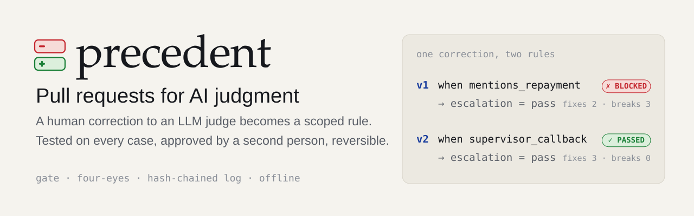
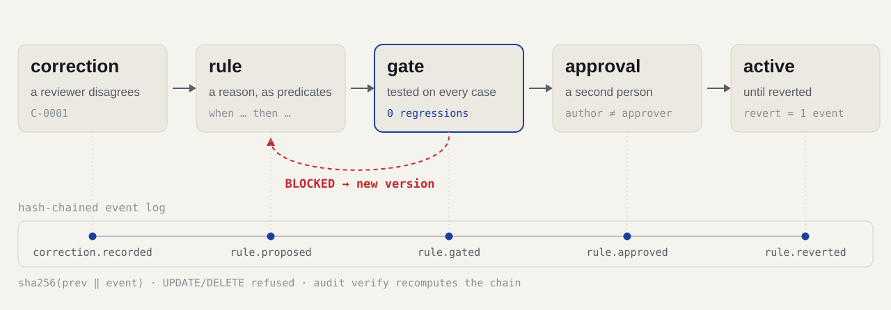
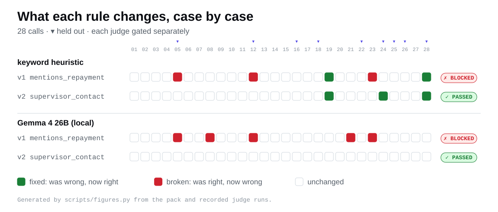

<p align="center">
  <picture>
    <source media="(prefers-color-scheme: dark)" srcset="docs/assets/banner-dark.svg">
    
  </picture>
</p>

<p align="center">
  <a href="#quickstart">Quickstart</a> ·
  <a href="docs/how-it-works.md">How it works</a> ·
  <a href="#results">Results</a> ·
  <a href="docs/essay.md">Essay</a> ·
  <a href="docs/what-v1-got-wrong.md">What v1 got wrong</a> ·
  <a href="docs/ROADMAP.md">Roadmap</a>
</p>

**Precedent is an open-source Python library and CLI that reviews changes to an
AI judge the way engineers review changes to code.** When a person corrects the
judge, the correction becomes a small rule that states its reason. A gate tests
the rule against every case the system has ever been checked on, a second person
approves it, one command reverts it, and every step lands in a hash-chained log.

Why it matters: teams that run an LLM as a judge (call QA, document review,
tariff classification, claims) have people check its decisions. Their
disagreements are the most valuable signal the system will ever get, and today
they are either lost or pasted into the prompt, untested and unreviewed.

<p align="center">
  
</p>

| one supervisor correction, two ways to generalise it | gate | fixes | breaks |
|---|---|---|---|
| v1: "the call mentions repayment" (what the hackathon version learned) | **blocked** | 2 | 3 |
| v2: "a supervisor or team lead offered contact" (the actual reason) | **passed**, then needs a second approver | 3 | 0 |

<sub>28 synthetic calls, 9 held out, one annotator: a test of the machinery, not
a benchmark. The v1 rule shipped in this project's first version, where the
evaluation reported <code>improved: True</code>
(<a href="docs/what-v1-got-wrong.md">post-mortem</a>).</sub>

### What you bring, what Precedent does

```text
 you bring                                  Precedent does
 ─────────                                  ──────────────
 a pack: rubric, yes/no predicates,   ──▶   runs your judge once per case, records it,
 policy text, labelled cases                verifies every quote against the case
 a judge: any OpenAI-compatible model ──▶   applies reviewed rules on top, in code
 reviewers who correct decisions      ──▶   gate · four-eyes approval · revert · log
                                            ──▶ final labels you can explain to an auditor
```

## Quickstart

Python 3.12+ and [uv](https://docs.astral.sh/uv/). No network, no model, under a
second once installed:

```bash
uvx --from git+https://github.com/FUYOH666/precedent precedent demo
```

From a clone:

```bash
git clone https://github.com/FUYOH666/precedent.git && cd precedent
uv sync --extra dev
uv run precedent demo
./scripts/verify_all.sh          # ruff, mypy --strict, tests, the demo; offline
```

With a real model on any OpenAI-compatible endpoint (LM Studio, vLLM, OpenRouter):

```bash
export PRECEDENT_LLM_BASE_URL=http://127.0.0.1:1234/v1    # default: local LM Studio
uv run precedent judge --pack collections-conduct --judge llm:<model> --db work/p.db --errors
```

The run is recorded under `work/judgements/`, so the gate can replay it exactly
with `--judge replay:<file>`.

## How it works

<p align="center">
  <picture>
    <source media="(prefers-color-scheme: dark)" srcset="docs/assets/lifecycle-dark.svg">
    
  </picture>
</p>

**The model perceives, code decides.** One call per case returns a label for
each rubric item, plus yes/no answers to a library of narrow predicates such as
"did the agent offer contact with a supervisor?". Every positive claim must quote
the case verbatim, or it is downgraded.

**Rules are written in predicates, not keywords or prompt text,** so their
effect is deterministic and cheap to re-check on thousands of cases:

```yaml
id: escalation-callback
version: 2
item: escalation_offered
when:
  - {predicate: supervisor_callback_offered, equals: "yes"}
then: pass
source_corrections: [C-0001]
examples: [CASE-019]
counter_examples: [CASE-005, CASE-023, CASE-025]    # required: where it must not apply
```

**The gate blocks** a rule if it:
- does not fix its own correction;
- changes a declared counter-example;
- turns *any* right answer wrong;
- conflicts with an active rule;
- lowers held-out agreement (reported with a paired bootstrap CI).

**Approval is bound to what the gate saw:** the rule's content hash, the data,
the judge, the recorded corrections and the active rule set. Change any of them
and the gate runs again. Authors cannot approve their own rules.

**The log is append-only SQLite with a hash chain.** `precedent audit verify`
recomputes it, so an edit is detected even when the triggers are bypassed. Case
text never enters the log.

More: [how it works](docs/how-it-works.md) · [writing a pack](docs/writing-a-pack.md)
· [the essay behind the design](docs/essay.md).

## Results

`collections-conduct` is a deliberately small pack: 28 synthetic calls, 9 held
out, one annotator. It tests the machinery; it is not a benchmark. Every number
and figure below is regenerated from the repository by `scripts/results.py` and
`scripts/figures.py`.

<p align="center">
  <picture>
    <source media="(prefers-color-scheme: dark)" srcset="docs/assets/flips-dark.svg">
    
  </picture>
</p>

| judge, no rules | agree with labels | held-out | where it is wrong |
|---|---|---|---|
| keyword heuristic (offline baseline) | 107/112 | 33/36 | misses callbacks from a team lead or manager (3), a threat without the usual keywords (1), one disputed label |
| Gemma 4 26B, local (LM Studio, MLX), recorded | 107/112 | 32/36 | gives a full verdict on an out-of-domain hotel call instead of abstaining (4), the same disputed label |

Three things the numbers show:
- **Quote verification earns its keep.** It downgraded two Gemma claims that an
  escalation was offered when no such line existed, one of them on the hotel call.
- **A rule is only safe relative to a judge.** The v1 keyword rule breaks 3 verdicts
  on the keyword judge and 5 on Gemma, which reads "can we agree on a payment
  date?" as a repayment offer. Every gate result records the judge it ran against,
  and re-gating on model upgrades is next on the roadmap.
- **Local is practical.** Median 18.5 s and about 1.9k tokens per call on an
  Apple Silicon Mac, with no data leaving the machine.

Full tables and every single disagreement:
[docs/results/collections-conduct.md](docs/results/collections-conduct.md).

## Design principles

1. **No quote, no claim.** A finding the judge cannot quote from the case does not count.
2. **State the reason, not the trigger.** A rule names the condition that made the
   human right, and the cases where it must not apply.
3. **Nothing that was right may become wrong.** Broken cases are counted one by one;
   an average cannot hide them.
4. **Two people, one log.** Author and approver differ; every step is an event
   anyone can verify.
5. **Offline by default.** Tests, the demo and the gate run without a network or a
   model; real model runs are recorded and replayed.

## Where this applies

The pattern fits any workflow where an AI makes many similar judgments, experts
correct some of them, and someone outside the team will ask "why did you decide
that?":

| domain | the judgment | a correction that should become a rule |
|---|---|---|
| customs and trade compliance | tariff code for a product description | "a general-purpose part goes to its own heading, not to the vehicle's" |
| contact-centre QA | did the call follow conduct policy | "a scheduled callback from a team lead is an escalation offer" |
| claims and AML triage | is this claim or alert worth a human | "this transfer pattern is payroll, not structuring" |
| content moderation | does this post break policy | "quoting a slur to report it is not using it" |
| coding agents | does this change follow team rules | "migrations go in a separate PR" |

Only the pack changes: rubric, predicates, policy, labelled cases. The judge, the
rules, the gate and the log stay the same.

## Limitations

- The packs are small and labelled by one person. There is no human–human
  agreement figure yet, so there is no ceiling to compare a judge against.
- A verified quote proves the words are in the case, not that they support the
  claim. Whether a quote is relevant is still a judgment, made by the model and
  checked by the reviewer.
- Rules can only use predicates the judge was asked; a new predicate means
  re-running the judge on every case.
- Actors are names given to the CLI, and a gate result is recorded by whoever
  ran it (anyone can re-run it; it is deterministic given the recorded judge
  outputs). Four-eyes approval stops mistakes, not impersonation; put it behind
  your own authentication.
- The log is tamper-evident, not tamper-proof: record the head hash somewhere
  else and check against it with `precedent audit verify --anchor`.
- Automated monitoring of employees' behaviour (as in call QA) is high-risk under
  the EU AI Act (Annex III, 4(b)). This tool documents oversight; it does not make
  a deployment compliant.

## Related work

Calibrating LLM judges with human feedback exists in evaluation platforms
(LangSmith Align Evals, Galileo's continuous learning with human feedback) and
in research on criteria drift (Shankar et al., *Who Validates the Validators?*,
UIST 2024). There, corrections become prompt context or few-shot examples. Here
a correction becomes a reviewed change with a scope, a gate and a revert. Beating
the "corrections as few-shot examples" baseline on a public benchmark is the next
milestone.

## Who builds this

Precedent is built at [Scanovich](https://scanovich.ai), an independent
applied-AI lab run by Aleksandr Mordvinov, working with AI agents as
collaborators (this repository included). We build AI-operated workflows where
a model does the reading and a person signs off: document intelligence,
evidence-grounded agents, and private inference that keeps data on your own
hardware.

Other open work in the same line:
- [**evidencegene-court**](https://github.com/FUYOH666/evidencegene-court): an
  adversarial AI court for digital forensics where findings without evidence are
  rejected at the API boundary.
- [**Services-BGE**](https://github.com/FUYOH666/Services-BGE): local embeddings,
  reranking and a retrieval eval harness on Apple Silicon.
- [**VoiceToText**](https://github.com/FUYOH666/VoiceToText): private, local voice
  typing.

**Working with us.** If experts in your organisation correct an AI's decisions
and those corrections go nowhere, or you need an AI workflow that can explain
itself to an auditor, start at [scanovich.ai](https://scanovich.ai). A typical
first step is a short review of a sample of your own decisions, done on your
hardware.

---

<sub>v1 of this project was "ConductGene Swarm", built for the UCWS Singapore 2026
hackathon and kept under the tag <code>v1-ucws-2026</code>. MIT licence.</sub>
