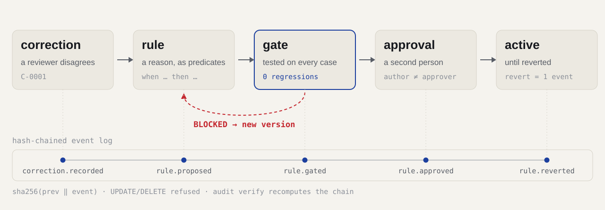

# How Precedent works

## The idea in one paragraph

An LLM judge labels cases (calls, declarations, findings) against a rubric.
People review a sample and disagree with some labels. Today those
disagreements end up as prompt edits nobody can audit, or they are lost.
Precedent treats each one like a code change: the correction becomes a small
rule with a stated scope, the rule is tested against everything the system
has ever been checked on, someone other than the author approves it, and it
can be reverted. Every step is an event in a hash-chained log.

## Perception by the model, decisions by code

The judge does two things in one call per case:

1. labels every rubric item, with a quote from the case for any positive
   finding and the policy clauses it relied on;
2. answers a library of narrow yes/no **predicates** about the case
   ("did the agent offer contact with a supervisor?"), again with a quote for
   every "yes".

Quotes are checked against the case text. A label without a verifiable quote
becomes `needs_review`; a "yes" without one becomes `unknown`. Rules never
read the case text: they read predicate answers. That makes a rule's effect
deterministic, cheap to re-evaluate, and explainable:

```yaml
id: escalation-callback
version: 2
item: escalation_offered
when:
  - {predicate: supervisor_callback_offered, equals: "yes"}
then: pass
source_corrections: [C-0001]
examples: [CASE-019]
counter_examples: [CASE-005, CASE-023, CASE-025]
```

`unknown` never satisfies a condition. If two active rules fire with different
labels, the item goes to human review; there is no "last rule wins".

## Lifecycle

<picture>
  <source media="(prefers-color-scheme: dark)" srcset="assets/lifecycle-dark.svg">
  
</picture>

Corrections carry an `error_type`. Only `policy_misinterpretation` and
`rubric_ambiguity` can justify a rule; a `misread`, `missing_context` or
`judge_noise` correction becomes a test case instead.

## The gate

The judge runs once per case; rules are applied by code. The gate evaluates
the candidate together with every active rule, on every labelled case plus
the cases behind accepted corrections.

| Check | Blocks when |
|---|---|
| `well_formed` | unknown item, label or predicate; no counter-example; a predicate the judge was never asked; missing judge outputs, outputs whose case hash does not match their case, or outputs from more than one judge; a source correction that is not rule-worthy; any accepted correction whose case was removed or changed |
| `source_fixed` | the correction the rule came from is not fixed, or the case changed since |
| `examples_fire` | the rule does not fire on its declared examples |
| `counter_examples_hold` | a declared counter-example changes at all, even towards its label |
| `no_regressions` | **any** labelled case goes from right to wrong |
| `no_conflicts` | the rule disagrees with an active rule on some case |
| `heldout_not_worse` | held-out agreement goes down (reported with a paired bootstrap 95% CI) |

Advisory checks report whether the rule fires beyond its own sources and on
how many cases the judge answered `unknown`.

A gate result is bound to the rule's content hash, the dataset hash, the
judge id, the set of recorded corrections and the hash of the active rule set.
If any of them changes afterwards, approval is refused until the gate runs
again. A report whose decision disagrees with its own blocking checks is
refused outright.

## The event log

SQLite, one table, append-only:
`hash = sha256(prev_hash + canonical(seq, ts, actor, type, payload))`.
Triggers refuse UPDATE and DELETE; `precedent audit verify` recomputes the
chain, so an edit made by bypassing the triggers is still detected, and
`--anchor <hash>` checks the log against a head hash you recorded elsewhere, which
also catches a cut-off tail. Every lifecycle command verifies the chain first and
refuses to act on a damaged log, and reads state, checks it and appends its
event inside one SQLite write transaction, so two processes cannot both approve
against the same state. Rule
state (proposed, blocked, passed, active, superseded, reverted, rejected) is
derived by replaying the log; it is never stored separately. Case text is not
written to the log, only case ids and content hashes.

## Judges

| Spec | What it is |
|---|---|
| `heuristic` | Regex predicates with a negation window and per-item decision lists from the pack. Offline test double and the "keyword rules" baseline. |
| `llm:MODEL` | Any OpenAI-compatible endpoint (LM Studio, vLLM, OpenRouter). Configure with `PRECEDENT_LLM_BASE_URL`, `PRECEDENT_LLM_API_KEY`. |
| `replay:PATH` | Recorded outputs of a real model, served offline. CI and the gate can reuse an expensive run exactly. |
